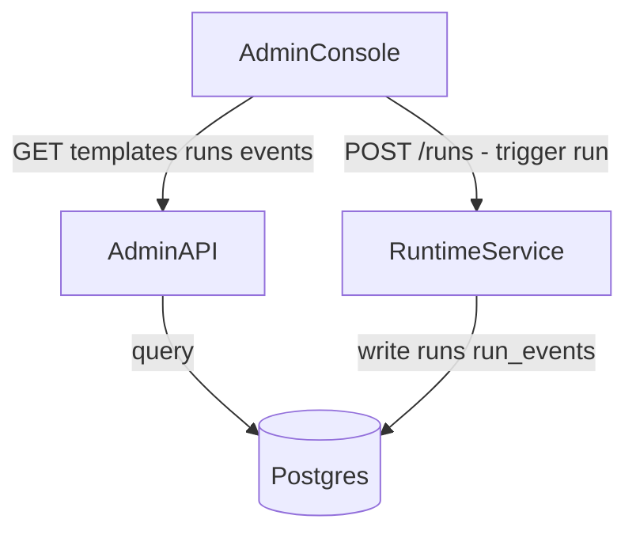

## Admin API and Admin Console Specification Document

### Goal

Create a new reference document that both admin-api and admin-console implementations will use when rewritten. The doc defines:

- **Postgres schema** for the runtime `templates` and `runs` tables (and `run_events` for live events)
- **Rewrite assumptions** (admin-api and admin-console will be rewritten)
- **Component responsibilities**: Admin Console triggers runs directly; Admin API queries Postgres for run status, live events, completion status, and templates.

---

### 1. Overview and Assumptions

- Both admin-api and admin-console are to be **rewritten** against this spec.
- Shared Postgres: runtime, admin-api, and templates all use the same database.
- No Redis or admin-api-specific tables (`agent_runs`, `agent_steps`, `agent_events`, admin-api `templates`): these are deprecated in favor of the runtime schema.

---

### 2. Architecture and Data Flow

- **Admin Console**: Calls Runtime API directly to trigger runs (`POST /runs`); calls Admin API for templates, run list, run status, and live events.
- **Admin API**: Read-only access to Postgres; serves templates, run status, run completion status, and live events to the admin-console.
- **Runtime**: Writes to `runs` and `run_events`; templates/pods write status and events via `templates/stuck-order-adk/run_db.py`.

---

### 3. Postgres Schema (Canonical)

Use the schema from `runtime/db/migrations/001_initial.sql` plus `runtime/db/migrations/003_claim_deleted_at.sql`.

#### Table: `templates`

| Column        | Type        | Constraints | Description                   |
| ------------- | ----------- | ----------- | ----------------------------- |
| template_id   | TEXT        | PRIMARY KEY | Unique template identifier    |
| name          | TEXT        | NOT NULL    | Display name                  |
| image         | TEXT        | NOT NULL    | Docker image for sandbox      |
| warm_pool_ref | TEXT        | nullable    | K8s SandboxTemplate reference |
| config        | JSONB       | nullable    | Template-specific config      |
| created_at    | TIMESTAMPTZ | NOT NULL    | Creation timestamp            |
| updated_at    | TIMESTAMPTZ | NOT NULL    | Last update timestamp         |

#### Table: `runs`

| Column             | Type        | Constraints  | Description                                 |
| ------------------ | ----------- | ------------ | ------------------------------------------- |
| run_id             | UUID        | PRIMARY KEY  | Unique run identifier                       |
| template_id        | TEXT        | NOT NULL, FK | References `templates(template_id)`         |
| status             | TEXT        | NOT NULL     | `pending`, `running`, `completed`, `failed` |
| payload            | JSONB       | NOT NULL     | Input payload to workflow                   |
| result             | JSONB       | nullable     | Output when status = `completed`            |
| error_message      | TEXT        | nullable     | Error when status = `failed`                |
| created_at         | TIMESTAMPTZ | NOT NULL     | Creation timestamp                          |
| updated_at         | TIMESTAMPTZ | NOT NULL     | Last update timestamp                       |
| completed_at       | TIMESTAMPTZ | nullable     | Set when status = `completed`/`failed`      |
| assigned_pod       | TEXT        | nullable     | K8s pod assigned to run                     |
| sandbox_claim_name | TEXT        | nullable     | SandboxClaim resource name                  |
| claim_deleted_at   | TIMESTAMPTZ | nullable     | When SandboxClaim was cleaned up            |

Indexes: `runs(template_id)`, `runs(status)`, `runs(created_at)`.

#### Table: `run_events`

| Column     | Type        | Constraints  | Description                                                                                                                   |
| ---------- | ----------- | ------------ | ----------------------------------------------------------------------------------------------------------------------------- |
| id         | SERIAL      | PRIMARY KEY  | Auto-increment event ID                                                                                                       |
| run_id     | UUID        | NOT NULL, FK | References `runs(run_id)` ON DELETE CASCADE                                                                                   |
| event_type | TEXT        | NOT NULL     | `workflow_started`, `tool_started`, `tool_completed`, `agent_started`, `agent_completed`, `llm_message`, `workflow_completed` |
| event      | TEXT        | NOT NULL     | Human-readable label                                                                                                          |
| payload    | JSONB       | nullable     | Event-specific data                                                                                                           |
| created_at | TIMESTAMPTZ | NOT NULL     | Event timestamp                                                                                                               |

Index: `run_events(run_id)`.

---

### 4. Admin API Responsibilities (Rewrite)

- **Query only** from Postgres (no writes).
- Endpoints for admin-console:
  - `GET /templates` — list templates from `templates`.
  - `GET /templates/{template_id}` — single template.
  - `GET /runs` — list runs with filters (template_id, status, pagination).
  - `GET /runs/{run_id}` — run status, result, `error_message`, timestamps.
  - `GET /runs/{run_id}/events` — live events for UI (or SSE/polling).
- Optionally: SSE or long-polling for live event streaming from `run_events`.
- **Does not** trigger runs; Runtime owns run creation and execution.

---

### 5. Admin Console Responsibilities (Rewrite)

- Trigger runs: `POST /runs` to **Runtime** (not Admin API) with `{ template_id, payload }`.
- Display data: use Admin API for templates, run list, run status, events.
- UI features:
  - Template selector and run trigger form.
  - Run list with filters (template, status, time range).
  - Run detail view with:
    - Current status and timestamps.
    - Final result / error message.
    - Live `run_events` stream (step-by-step view).

---

### 6. Runtime API (Existing, No Rewrite)

- `POST /runs` — create run and enqueue sandbox trigger.  use this.
- `GET /runs/{run_id}` — run status (`status`, `result`, `error_message`, timestamps).   dont use this instead write logic for this in admin api
- `GET /runs/{run_id}/events` — events as stored in `run_events`.  dont use this instead write logic for this in admin-api

Admin-console **may** read directly from Runtime, but the preferred pattern is:

- Admin-console → Admin API for reads.
- Admin-console → Runtime only for triggering runs.

---

### 7. Event Types Reference

From `templates/stuck-order-adk/workflow_runner.py`, current event types written into `run_events.event_type`:

- `workflow_started`
- `tool_started`
- `tool_completed`
- `agent_started`
- `agent_completed`
- `llm_message`
- `workflow_completed`

Admin-console UIs should treat this list as extensible; new event types may be added over time.

---

### 8. Run Status Values

Canonical `runs.status` values:

- `pending`
- `running`
- `completed`
- `failed`

Admin-console displays human-friendly labels for these values and derives visual state (e.g. colors, progress indicators) from them.

---

### 9. Ownership and Migrations

- **Runtime** owns schema migrations for `templates`, `runs`, and `run_events` (see `runtime/db/migrations`).
- **Admin API** connects to the same Postgres instance in **read-only** mode (at the application level) and must not run conflicting migrations.
- **Templates** and sandbox pods use the shared Postgres instance via the thin client in `templates/*/run_db.py` to write run status and events.

