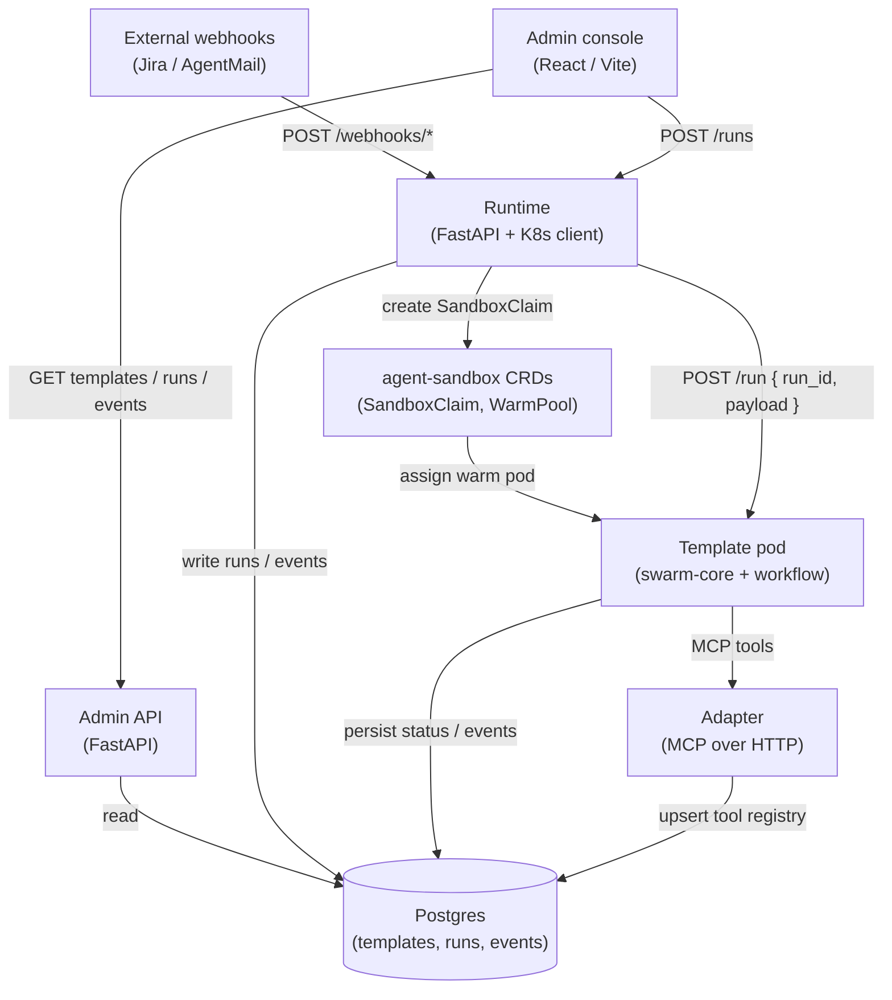

# Platform architecture

SWARM splits **orchestration** (who runs what, when) from **execution** (the agent loop inside a pod) and **integrations** (telecom and desk tools behind one MCP service).

## System diagram

## The five platform pieces

<CardGroup cols={2}>
  <Card title="Runtime" icon="🎯" href="/service-runtime">
    Creates **runs**, reconciles **SandboxClaims**, triggers template pods, handles **Jira** and **AgentMail** webhooks, runs **follow-up** and **pending-reply** background workers.
  </Card>
  <Card title="Adapter" icon="🔌" href="/service-adapter">
    Single **MCP** server over HTTP: telecom and desk **tools** (`adapter__tool` names) backed by mocks or real APIs (e.g. Jira when configured). Writes **`adapter_tool_registry`** in Postgres.
  </Card>
  <Card title="Admin API" icon="🗄️" href="/service-admin-api">
    Read-heavy REST API: **templates**, **runs**, **run_events**, **adapters/tools**. Proxies **webhook-style run creation** to the runtime. Supports **PATCH** to update **`workflow_yaml`** on a template row.
  </Card>
  <Card title="Admin console" icon="🖥️">
    Web UI: browses templates and runs, visualizes flow and events. Talks to **Admin API** and sometimes **Runtime** directly (configurable base URLs).
  </Card>
  <Card title="swarm-core (template pods)" icon="📦" href="/service-swarm-core">
    Shared **base image**: FastAPI **`POST /run`**, Google **ADK** runner, YAML-driven **stages** (LLM + MCP). One pod image per template (YAML baked in or loaded from DB).
  </Card>
</CardGroup>

## End-to-end run flow

1. **Trigger** — A client calls **`POST /runs`** on the runtime with `template_id` and `payload`, or a **Jira** / **AgentMail** webhook creates the same shape internally.
2. **Persist** — Runtime inserts a **run** row (`pending`) in Postgres.
3. **Allocate** — Runtime creates a **SandboxClaim**; the agent-sandbox controller binds a **warm** pod from the pool for that template (or scales as configured).
4. **Execute** — Runtime **`POST`s** to the pod’s **`/run`** with `run_id` and `payload`. The pod loads **workflow YAML** from disk (`YAML_PATH`) or from **`templates.workflow_yaml`**.
5. **Tools & LLM** — **swarm-core** runs the workflow: **MCP** calls go to **`ADAPTER_URL/mcp`**, LLM calls use **OpenRouter** (via LiteLLM).
6. **Finish** — The pod updates **run** status and appends **run_events** (tool calls, stages, LLM snippets, errors).

## Warm pool (one paragraph)

Each **template** can have a **SandboxWarmPool** in Kubernetes: a number of **idle** pods running that template’s image. When a run starts, a **SandboxClaim** grabs an idle slot so execution begins quickly instead of waiting for a cold pull. Pool size and image are operational choices per template (see [Infrastructure](/infrastructure)).

## Cross-service communication

<Callout type="info" title="How services talk">
  Base URLs for the admin console are often **Kind-style** port forwards (**30081** / **30080**); production uses ingress hostnames from Terraform.
</Callout>

| From | To | Mechanism |
|------|-----|-----------|
| Console | Admin API | HTTP (`VITE_ADMIN_API_URL`, often port **30081** in Kind) |
| Console | Runtime | HTTP (`VITE_RUNTIME_API_URL`, often **30080**) |
| Admin API | Runtime | **`POST /runs`** when using webhook proxy routes |
| Runtime | K8s API | **SandboxClaim** CRs |
| Runtime | Template pod | **`POST http://<pod>:8888/run`** (configurable port) |
| Template pod | Adapter | **Streamable HTTP MCP** at **`{ADAPTER_URL}/mcp`** |
| Template pod | Postgres | Async SQLAlchemy (`DATABASE_URL`) |
| Adapter | Postgres | **`adapter_tool_registry`** upsert on startup |
| External | Runtime | **Jira** (`X-Hub-Signature` or Bearer), **AgentMail** (signed webhooks) |

## Related reading

- [Core concepts](/concepts) — glossary of terms used above.
- [Runtime service](/service-runtime) — API and webhook details.
- [swarm-core](/service-swarm-core) — pod entrypoint and workflow engine.
