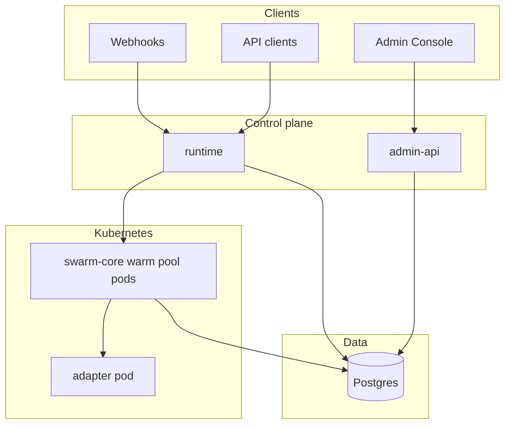

# Architecture

## Mental model

1. **Postgres** is the system of record for **templates**, **runs**, **run_events**, adapter **tool registry**, and (where used) **communication threads** for inbound email routing.
2. **Runtime** creates runs and drives execution by creating a **SandboxClaim** against a **warm pool** of identical **swarm-core** pods on Kubernetes. Each claimed pod loads **workflow YAML** for the run from Postgres (by `run_id`).
3. **swarm-core** (inside the pod) validates YAML, runs the **ADK** (Agent Development Kit) **Runner** with a root agent built from stages/steps, and calls the **adapter** over **MCP** (Model Context Protocol) **Streamable HTTP** at `{ADAPTER_URL}/mcp`.
4. **Admin API** exposes the same database to **Admin Console** for operations and template YAML management.
5. **Follow-up** and **inbound reply** paths are coordinated by **runtime** background tasks (pollers/workers) that re-trigger the sandbox with merged payload context — see [Follow-up lifecycle](/concepts/follow-up-lifecycle).

## Runtime vs admin-api vs adapter

| Layer | Responsibility |
|-------|----------------|
| **Runtime** | Run creation, webhook ingress, **SandboxClaim** + `POST` to pod entrypoint, **follow-up poller**, **pending reply worker**, **claim reconciler** |
| **Admin API** | Query and update API for operators; **does not** execute workflows in-process |
| **Adapter** | MCP tool server: normalizes calls to external systems so workflows stay declarative |

## Warm pool and execution

Templates reference a **`warm_pool_ref`** (typically `swarm-core-pool`). The runtime does not schedule arbitrary images per template in the default design: **one shared pool** of **swarm-core** images; **workflow YAML** is loaded per run from the database. See [Warm pool](/concepts/warm-pool).

## ADK and MCP inside the pod

- **ADK** — The pod uses Google’s Agent Development Kit patterns: a **root agent** is built from validated YAML (**stages** → **steps** such as `mcp_call`, `llm_agent`, `condition`).
- **MCP** — Tool calls go to the **adapter** service (cluster DNS, e.g. `http://adapter:8080/mcp`). The adapter registers tools (Jira, AgentMail, Siebel, …) and persists tool metadata to **`adapter_tool_registry`** for discovery in the Admin Console.

## Shared database

Runtime and admin-api both use **`DATABASE_URL`** against the same Postgres. Migrations under `runtime/db/migrations/` evolve the shared schema.

## Further reading

- [Data flow](/concepts/data-flow)
- [Warm pool](/concepts/warm-pool)
- [Follow-up lifecycle](/concepts/follow-up-lifecycle)
- [Event system](/concepts/event-system)
- [Repository layout](/concepts/repo-layout)
- Repository root `README.md` — component list
