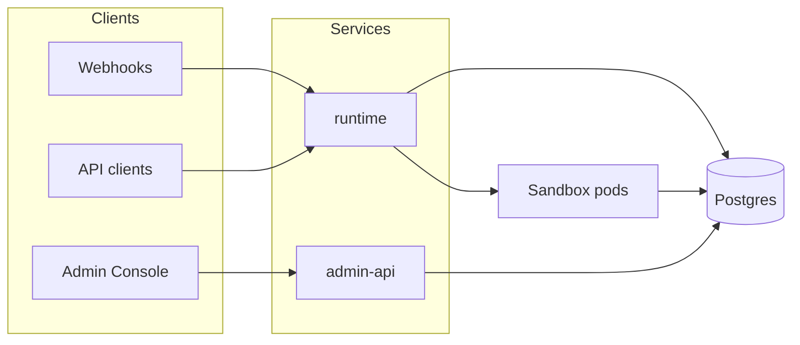
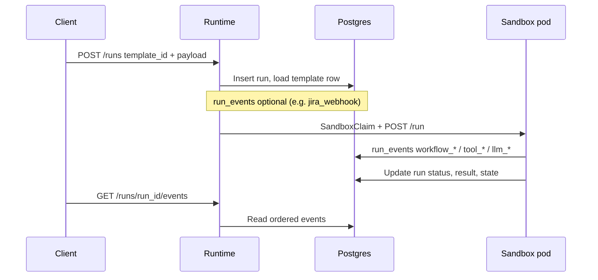
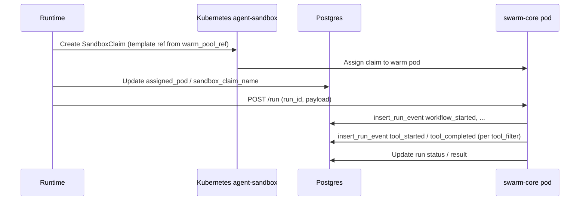
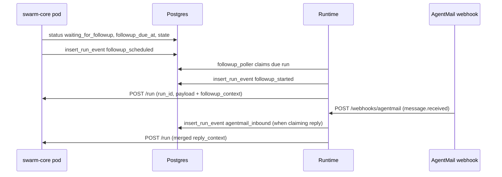

# Data flow

## Control plane overview

## Run lifecycle (initial trigger)

## Warm pool claim flow

The runtime does not `kubectl run` a one-off pod per execution. It creates a **SandboxClaim** that binds a **pre-warmed** pod from **SandboxWarmPool** (see [Warm pool](/concepts/warm-pool)). When the pod hostname is ready, the runtime **POST**s `{ run_id, payload }` to the pod HTTP entrypoint.

## Follow-up and inbound reply flow

When **`follow_up.mode: agentmail`** is in the workflow YAML, the pod may set **`waiting_for_followup`** and **`followup_due_at`**. The **followup_poller** emits **`followup_started`** and re-triggers the sandbox with **`followup_context`** in the payload. **AgentMail** webhooks can enqueue **engineer replies**; **`pending_reply_worker`** merges **`reply_context`** and triggers again. See [Follow-up lifecycle](/concepts/follow-up-lifecycle).

## Template registry

Rows in **`templates`** include **`template_id`**, **`image`**, **`warm_pool_ref`**, optional **`workflow_yaml`**, and metadata used by the runtime to choose the warm pool and configuration.
