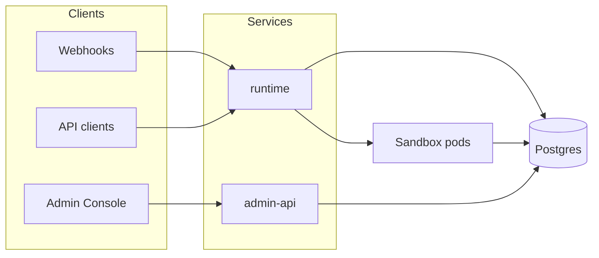
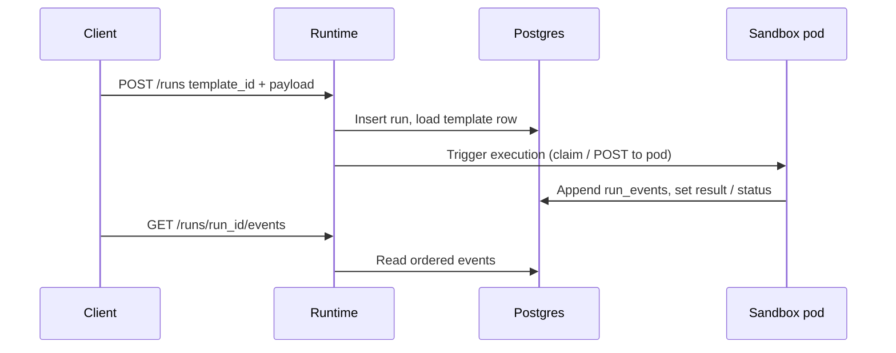

# Data flow

## Control plane overview

## Run lifecycle (simplified)

## Template registry

Rows in `templates` include `template_id`, `image`, optional `workflow_yaml`, and metadata used by the runtime to choose the container image and configuration.

## Product-specific diagrams

Some legacy sequence diagrams under `bible/diagrams/` describe product demos (e.g. retail flows). For **orchestration mechanics**, treat this page and `runtime/README.md` in the repo as canonical.
