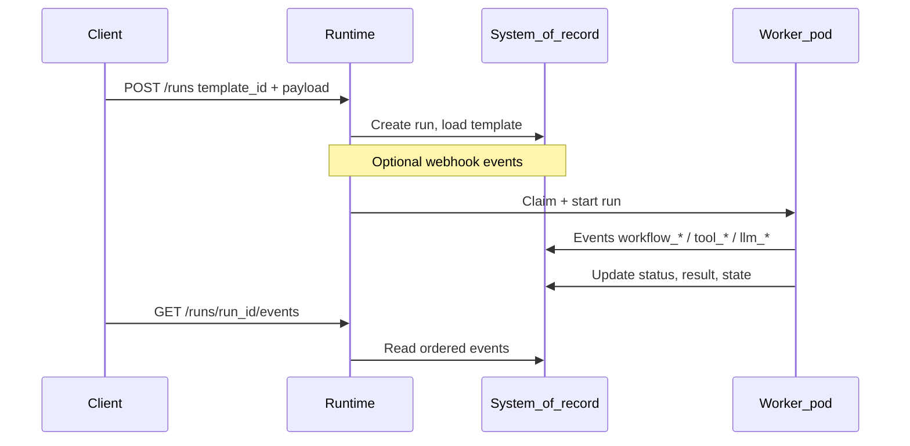
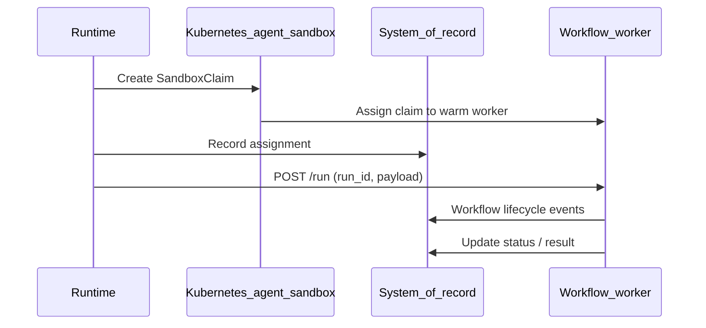
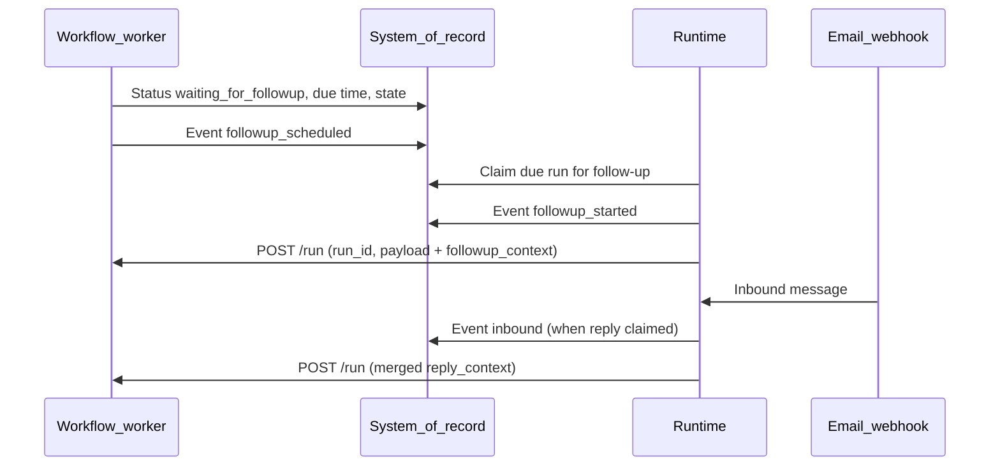

# Data flow

## Control plane overview

## Run lifecycle (initial trigger)

## Warm pool claim flow

The Runtime does **not** start a **one-off** pod per execution. It creates a **SandboxClaim** that binds a **pre-warmed** worker from the **warm pool** (see [Warm pool](/concepts/warm-pool)). When the worker is ready, the Runtime **POST**s **`run_id`** and **payload** to the worker’s HTTP entrypoint.

## Follow-up and inbound reply flow

When **follow-up** is configured for **email** in workflow YAML, the worker may set **waiting for follow-up** and a **due time**. The **Runtime** **follow-up** loop picks up **due** runs, records **follow-up started**, and **re-invokes** the worker with **follow-up context**. **Inbound email** webhooks can deliver **engineer replies**; a **reply** path **merges** context and **triggers** execution again. See [Follow-up lifecycle](/concepts/follow-up-lifecycle).

## Templates and configuration

Each **template** has an identifier, optional **container image** metadata, a **warm pool** reference, **workflow YAML**, and **configuration** the Runtime uses to route execution. See [Templates](/guides/templates).
