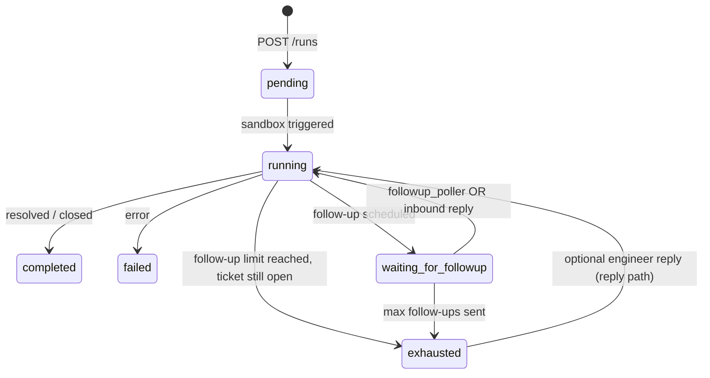

# Follow-up lifecycle

Workflows that use **`follow_up.mode: agentmail`** (see [Workflow YAML](/guides/workflow-yaml)) can schedule **proactive follow-ups** and handle **engineer replies** in the same email thread. The **runtime** and **swarm-core** cooperate: YAML configures limits and intervals **inside the pod**; the **runtime** schedules the next sandbox invocation when the timer fires or when an inbound webhook arrives.

## YAML configuration (pod)

The **`follow_up`** block in workflow YAML (validated by **`swarm_core.schema.WorkflowSchema`**) includes:

| Field | Meaning |
|-------|---------|
| **`mode`** | **`none`** or **`agentmail`** |
| **`limit`** | Maximum number of **proactive** follow-up sends (default **3**) |
| **`interval_seconds`** | Delay before the next follow-up (or after a reply), **runtime** poller uses this schedule |
| **`email_result_key`** | Which result key holds the outbound email payload (for AgentMail flows) |

The **runtime follow-up poller does not read the YAML file** — it uses **`followup_due_at`** and **`state`** stored on the **`runs`** row.

## State machine (simplified)

Exact **`status`** strings and transitions are implemented in **`swarm_core.followup_agentmail`** and **`runtime`** DB helpers.

## 1. Scheduled follow-up (poller)

1. The pod finishes work and sets **`status = waiting_for_followup`**, **`followup_due_at`**, and JSON **`state`** (thread ids, counts, etc.).
2. **`followup_poller`** runs every **`FOLLOWUP_POLLER_INTERVAL_SEC`** (default **5**).
3. For due rows, **`claim_followup_run`** atomically marks the run as **claimed** for follow-up.
4. Runtime inserts **`followup_started`** into **`run_events`** (see [Event system](/concepts/event-system)).
5. Merged payload includes **`followup_context`** from **`state`**; **`trigger_sandbox_post_run`** runs the workflow again.

## 2. Engineer reply (AgentMail webhook)

1. **AgentMail** sends **`POST /webhooks/agentmail`** (`event_type: message.received`) to the **runtime**.
2. The runtime verifies **Svix** signatures using **`AGENTMAIL_WEBHOOK_SECRET`**.
3. If the run is **busy** (`pending`, `running`, `processing_reply`, or `follow_up_in_progress`), the message is **queued** for later.
4. Otherwise the runtime **claims** the run for reply, inserts **`agentmail_inbound`**, merges **`reply_context`**, and calls **`trigger_sandbox_post_run`**.

**`pending_reply_worker`** drains queued messages when the run becomes idle.

## 3. Exhaustion

When **`follow_up_count`** reaches **`FOLLOW_UP_LIMIT`** and the ticket is still open, the run may transition to **`exhausted`**. Proactive follow-ups stop; **engineer replies** may still be handled depending on workflow logic (see code in **`followup_agentmail.py`**).

## Further reading

- [Data flow](/concepts/data-flow)
- [Event system](/concepts/event-system)
- [Runtime API](/reference/runtime-api) — webhooks
