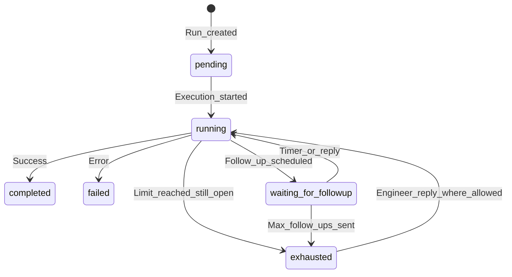

# Follow-up lifecycle

Workflows that use **follow-up** with **email** can schedule **proactive follow-ups** and handle **engineer replies** in the same thread. The **workflow engine** and **Runtime** work together: **YAML** sets **limits** and **intervals**; the **Runtime** schedules the next **execution** when a **timer** is due or when an **inbound** message arrives.

---

## YAML configuration (in the workflow)

The **`follow_up`** block in workflow YAML includes:

| Field | Meaning |
|-------|---------|
| **mode** | **`none`** or **email** integration mode (for example **agentmail**) |
| **limit** | Maximum **proactive** follow-up sends |
| **interval_seconds** | Delay before the next follow-up (or after a reply), used with **scheduled** re-runs |
| **email_result_key** | Which **result** field holds **outbound** email metadata |

The **Runtime** **scheduler** uses **timestamps** and **status** stored on the **run**. It does **not** re-parse YAML on every tick.

---

## State machine (simplified)

Exact **status** strings and **transitions** follow **workflow** and **platform** rules for your deployment.

---

## 1. Scheduled follow-up

1. The **workflow** finishes a slice of work and sets **waiting for follow-up** with a **due time** and **state** (thread identifiers, counts, and similar).
2. A **background** process in the **Runtime** looks for **due** runs on an interval.
3. It **claims** the run for follow-up, records a **follow-up started** style event, and **re-invokes** execution with **follow-up context** merged into the **payload**.

---

## 2. Engineer reply (inbound webhook)

1. The **email** provider delivers an **inbound** event to the **Runtime** webhook.
2. The **Runtime** **verifies** the request per your **secret** configuration.
3. If the run is **busy** (for example **running** or **processing a reply**), the message may be **queued** and **drained** when the run is **idle** again.
4. Otherwise the **Runtime** **claims** the run for reply, records an **inbound** event, merges **reply context**, and **re-invokes** execution.

---

## 3. Exhaustion

When **follow-up count** reaches the **limit** and the underlying **ticket** is still **open**, the run may move to **exhausted**. **Proactive** follow-ups **stop**; **engineer replies** may still be handled depending on **workflow** rules.

---

## Further reading

- [Workflow YAML](/guides/workflow-yaml): **`follow_up`** block
- [Data flow](/concepts/data-flow)
- [Event system](/concepts/event-system)
- [Runtime API](/reference/runtime-api): webhooks
