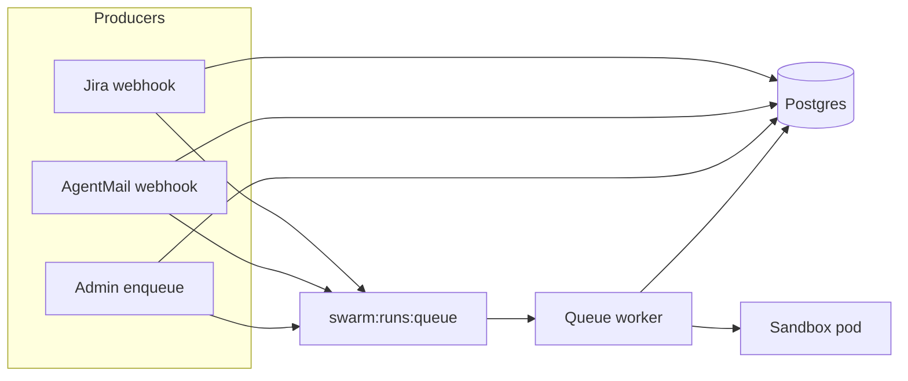

# Redis run queue

## Purpose

Some entry points must return an HTTP response immediately while the expensive work runs afterward: creating a SandboxClaim, waiting for a warm pool pod, and sending an HTTP request to the sandbox entrypoint (where swarm-core runs the workflow). Those producers persist the run in Postgres—usually with status `queued`—and publish a message to Redis. A long-lived **queue worker** inside the runtime consumes those messages and drives the same trigger path used for direct runs, without blocking the webhook or enqueue handler.

## How it works (Redis Streams)

SWARM does not use a simple list or Pub/Sub for this handoff. It uses **Redis Streams** so work is durable, inspectable, and safe to share across multiple runtime replicas.

- **Stream**: Messages are appended with `XADD` to the stream key `swarm:runs:queue`. Each message carries fields `run_id`, `template_id`, and `payload` (JSON string), matching [Admin API](/reference/admin-api) `POST /runs/enqueue` and the runtime webhook handlers.
- **Consumer group**: The worker joins the group `runtime-workers`. That lets several runtime instances cooperate: each message is delivered to one consumer. You can set `QUEUE_WORKER_CONSUMER_NAME` so each pod has a stable consumer name (default is derived from the hostname).
- **Processing**: For each message, the worker sets the run to `pending`, then calls the sandbox trigger (`SandboxClaim` plus POST to the pod). On success it **ACK**s the message. On a retryable error (for example the pod not ready in time), it **does not ACK**, so the message can be reclaimed—`XAUTOCLAIM` recovers stuck pending entries after a timeout. Invalid or permanently failed work can be recorded on the dead-letter stream `swarm:runs:dead`.

When `REDIS_URL` is unset, the runtime does not start this worker and cannot append to the stream for the paths below.

The diagram shows the common path: producers write the run row and push to the stream; the worker reads the stream, updates Postgres as needed, and talks to the sandbox. The AgentMail path can skip the stream when the run is busy—see below.

## Which paths use it

- **Jira webhook** (`/webhooks/jira` on the runtime): After signature or bearer checks, a background task creates the run and a `jira_webhook` event in Postgres, then `XADD`s to `swarm:runs:queue`.
- **Admin API** `POST /runs/enqueue`: Creates a run with status `queued` in Postgres and `XADD`s the same fields to the stream. Requires Redis on admin-api and a running worker on the runtime.
- **AgentMail webhook** (`/webhooks/agentmail` on the runtime): After Svix verification, processing may **not** touch Redis. If the run is busy (`pending`, `running`, `processing_reply`, or follow-up in progress) or the reply cannot be claimed yet, inbound content is stored via Postgres (`enqueue_pending_inbound`) instead of the stream. Only when a reply is ready to execute and Redis is available does the handler `XADD` to the stream.

## Requirements

- **Redis** reachable from the **runtime** (stream consumer and runtime-side producers).
- `**REDIS_URL`** on the runtime so the queue worker starts and Jira/AgentMail can enqueue.
- `**REDIS_URL**` on **admin-api** if you use `POST /runs/enqueue`.
- If Redis is missing or misconfigured, queue-backed paths cannot complete: the worker never runs, and runtime producers log errors instead of enqueueing.

## Further reading

- [Data flow](/concepts/data-flow) — Runs, claims, and sandbox execution
- [Architecture](/concepts/architecture) — How services fit together
- [Warm pool](/concepts/warm-pool) — Where sandbox pods come from
- [Deployment](/guides/deployment) — Compose, Kubernetes, and wiring services

