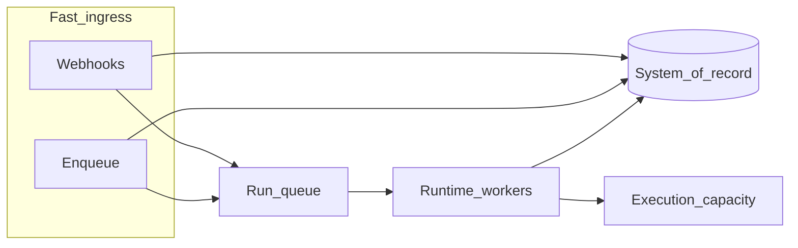

# Run queue

Some paths into SWARM must **return an HTTP response immediately**: webhooks from external products, high-volume ingress, or operator actions where waiting for **warm capacity** and **workflow startup** would time out or frustrate callers. The **run queue** is the platform’s answer: **record the run**, **acknowledge quickly**, then **process execution** on a **reliable, durable** path that scales with your **Runtime** deployment.

---

## What problem it solves

Without a handoff layer, every trigger would have to **block** until execution is fully underway. That is fragile for:

- **Webhooks:** upstream systems expect **prompt** HTTP responses.
- **Burst traffic:** spikes should not translate into **lost** or **duplicated** work.
- **Multiple Runtime replicas:** work should be **claimed once** and **completed** safely.

The run queue lets **ingress** stay fast and **execution** stay **orderly**.

---

## What it does (conceptually)

<Steps>
  

    **Producers**

    A run is **created** in the system of record (often with a **queued** status where appropriate), then a **message** is published that says “run this work.”
  

  

    **Consumers**

    **Runtime workers** read messages, move runs toward **execution**, and **assign warm capacity** the same way as direct triggers.
  

  

    **Durability**

    Messages are **not fire-and-forget**: if a worker restarts, work can be **picked up again** without manual repair.
  

  

    **Dead-letter handling**

    **Persistently invalid** work can be **isolated** so it does not block the stream. Operators can investigate without guessing.
  

</Steps>

Under the hood, SWARM uses a **stream-backed** design so multiple consumers can cooperate and **pending** messages can be **recovered** after timeouts. Operators configure **shared memory** (cache) connectivity for **Runtime** and **Admin API** where enqueue is used. See [Environment variables](/reference/environment-variables).

---

## When it is used

Typical producers include:

- **Inbound webhooks** that **create** runs and must **return quickly**.
- **Admin enqueue:** operators or automation **queue** a run after it exists in the system of record.

Some inbound paths may **merge** or **delay** work when a run is **already busy** (for example **concurrent** human replies). Those flows are described in [Data flow](/concepts/data-flow) and [Follow-up lifecycle](/concepts/follow-up-lifecycle).

<Callout type="warning" title="Queue backend required">
  If **no** queue backend is configured, **queue-backed** paths **do not** run end-to-end. Configure the platform for your environment or use **direct** Runtime triggers instead.
</Callout>

---

## What operators need to know

| Topic | Guidance |
|-------|----------|
| **Availability** | Runtime must be configured to **enable** background processing; **enqueue** from Admin requires **consistent** configuration where your deployment expects it. |
| **Scaling** | Multiple **Runtime** instances can **share** consumer responsibility. Horizontal scaling stays **safe** for the stream model. |
| **Observability** | Monitor **lag** and **failed** messages like any mission-critical queue; pair with **run status** and **events** in the Admin Console. |

---

## Diagram

---

## Further reading

- [Runtime](/concepts/runtime)
- [Data flow](/concepts/data-flow)
- [Warm pool](/concepts/warm-pool)
- [Deployment](/guides/deployment)
- [Admin API reference](/reference/admin-api) (enqueue endpoint)
