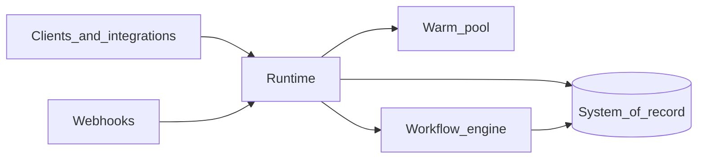

# Runtime

The **Runtime** is SWARM’s **orchestration service**. It is the **front door** for starting and continuing work: HTTP APIs for runs, **webhooks** from external products, and **background tasks** that keep long-running and multi-step scenarios on track.

---

## What problem it solves

Automations do not exist in isolation. They are triggered by tickets, emails, schedules, and partner systems, often **many at once**, and often with a need to **acknowledge quickly** while heavier work continues safely. The Runtime exists to:

- **Create and track runs** with a clear identity and status from the first request through completion or handoff.
- **Connect external events** (for example ticketing or email platforms) to the right template and payload.
- **Coordinate execution** by assigning **warm execution capacity** and handing off to the workflow engine, without embedding business rules in the orchestration layer itself.
- **Support follow-up and reply flows** where work pauses and resumes (for example when a human replies or a timer fires).

In short: the Runtime **owns the lifecycle** of a run; the **workflow engine** owns the **logic** inside a run.

---

## Why Runtime and Admin API are separate

**Runtime** is optimized for **ingress and execution coordination:** high-volume triggers, webhooks, and driving the execution path.

**Admin API** is optimized for **operators and integrations** that manage configuration and inspect state: templates, run history, events, adapter discovery, and enqueue.

Both work against the same **system of record**, but **splitting concerns** keeps trigger paths focused and operator APIs stable for consoles and automation. See [Admin API](/concepts/admin-api).

---

## What the Runtime does (at a glance)

| Capability | Why it matters |
|------------|----------------|
| **Run API** | Create runs with a template and payload; query run status and streamed history where exposed. |
| **Webhooks** | Turn external events into runs or continuations with verification appropriate to each source. |
| **Execution handoff** | Reserve **warm capacity**, deliver **payload** to the workflow engine, and record assignment for operations. |
| **Background processing** | When triggers must return immediately, work can continue via a **durable handoff**. See [Run queue](/concepts/redis-queue). |
| **Follow-ups & replies** | For workflows that wait on timers or human replies, background processing **re-enters** the workflow with merged context. See [Follow-up lifecycle](/concepts/follow-up-lifecycle). |
| **Cleanup** | When a run reaches a terminal state, associated **execution claims** are cleaned up so capacity returns to the pool predictably. |

---

## How it fits into SWARM

**Triggers** arrive at the Runtime. It **persists** the run, **coordinates** execution on the **warm pool**, and the **workflow engine** performs the steps defined in **workflow YAML**, using the **Adapter** for tools. Progress and outcomes land back in the **system of record** for the Admin Console and APIs.

---

## Further reading

- [Platform overview](/concepts/architecture)
- [Workflow engine](/concepts/workflow-engine)
- [Run queue](/concepts/redis-queue)
- [Warm pool](/concepts/warm-pool)
- [Data flow](/concepts/data-flow)
- [Runtime API](/reference/runtime-api)
